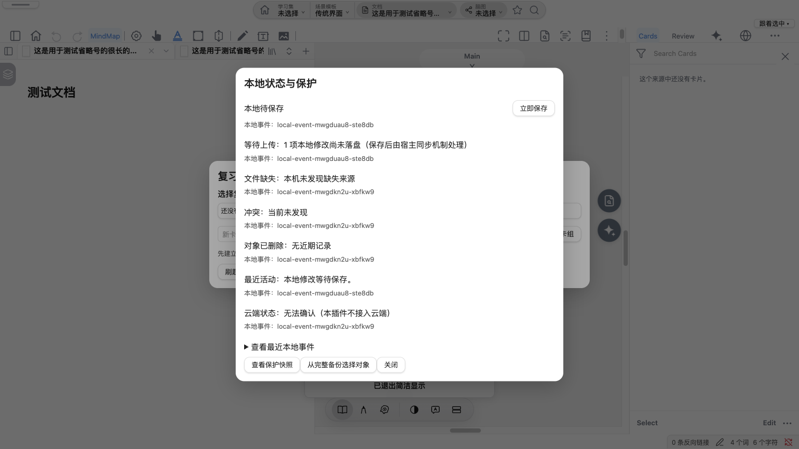
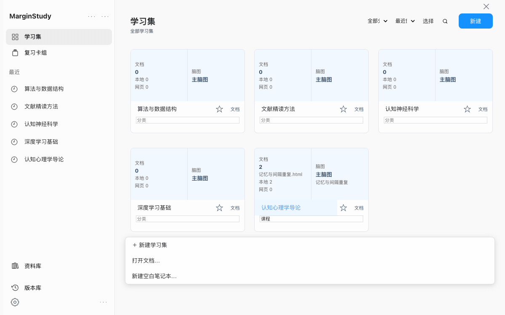
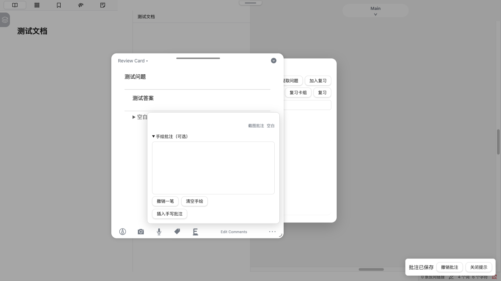

# MarginStudy

[](LICENSE) [](https://github.com/themiskang/margin-study/releases)


<p align="center">
  
</p>

**三句话认识它**

1. 在 Obsidian 里做完整闭环：**阅读 → 摘录 → 卡片 → 脑图 → 复习**，不用在几个工具之间倒数据。
2. PDF 和网页都能批注，**手写可分层、可跨页**；摘录与卡片双向联动，文档改名或换文件夹后关联不断。
3. 数据全部在你自己的库里（Markdown/JSON），可导出、可跨库迁移，**不上传任何服务器**。

<p align="center">
  
</p>

<p align="center">
  
</p>

## 安装

1. 打开 [Releases](https://github.com/themiskang/margin-study/releases)，下载最新版的 `main.js`、`manifest.json`、`styles.css`、`pdf.worker.js`。
2. 在你的 Obsidian 库中建立目录 `.obsidian/plugins/margin-study/`，把 4 个文件放进去。
3. 重启 Obsidian → 设置 → 第三方插件 → 关闭安全模式 → 启用 **MarginStudy**。

要求 Obsidian 1.4.0 及以上。已知问题见 [已知问题](docs/known-issues.md)。

## 文档

- [用户使用教程](docs/使用教程.md)
- [当前状态](docs/STATUS.md) · [路线图](docs/ROADMAP.md) · [MN5 差距](docs/MN5-PARITY-GAP.md)
- [架构决策](docs/architecture/decisions-mn502.md) · [实现差异](docs/architecture/implementation-deltas.md) · [技术评审](docs/architecture/optimization-review.md)
- [5.0.2 规格](docs/specs/mn5-5.0.2-delta.md) · [完整验收定义](docs/specs/full-mn5-replication.md) · [菜单矩阵](docs/specs/page-menu-state-matrix.md)
- [阶段验收与历史归档](docs/archive/README.md)

## 当前能力

- 页内自由文字编辑与底部字体/字号、B/I/U、前景/背景色栏；局部富文字、独立草稿和安全片段持久化；实际 PDF/Word 保存与重载已复核。
- 进入学习收起宿主双侧栏并隐藏 Claudian 浮窗，离开恢复，学习中手动展开侧栏保持可用。
- 文档内目录、缩略图、书签、手写标注、卡片五标签导航，当前文档来源过滤与原文定位；导航和文档阅读状态保存恢复。
- 普通PDF的顶部 Document - More 八个核心入口：书签、Edit PDF Pages、Crop、跳页、文档笔记本、卡片看板、阅读设置、显示文档标签；完整原版菜单仍有缺项。原完整工具移至“学习集更多设置→工作区设置…→阅读与批注的全部工具”。
- PDF Crop 灰底八红手柄，内裁/向外扩页、Done 保存、Esc 取消；按文档保存全页边界，正文/文字/旧批注/笔迹/语音/缩略图一致投影。原生保存/重开、扩展区书写/撤销/重做及插件重载已复核；原 PDF 和旧批注不改写。基础页编辑的空白插页、旋转、移动、删除及重开已完成列明范围；文件/图片插页、页编辑导出/撤销与 Extend 留白仍未完成。
- 阅读设置五主题、PDF 横竖方式及 UI Theme 子集；暗色中性字显示与存储颜色分开，Word/HTML 先预留导航栏再恢复阅读位置；全套设置、图片原色校正和原生手势/动画仍待完成。
- 新建笔迹撤销真正移除无引用、无后续修改的记录；重做恢复完整身份与内容，既有来源容器和独立备注受到保护。原生 Undo/Redo/重载已复核；历史空记录保留。
- PDF、Word、静态 EPUB / HTML / Markdown 阅读与批注；PDF 旋转/裁剪/缩放的统一坐标、跨页选区、原文跳转历史。
- 多文档学习集、最近合格脑图恢复、独立画布、共享内容引用、独立克隆、断开引用与按内容分割。
- 合并组员记录与当前实体恢复、来源/图片/互链保留、解除后继续保留已经完成的复习与后来编辑。
- 整卡遮挡、跨页临时揭晓/收回、singlePeek、强调即挖空、选中文本挖空及纯视图显隐。
- 显式复习队列、按脑图隔离的四档 ts-fsrs 调度、普通文本挖空及 cN 扩展、矩形图片遮挡题、复习批注/手绘/快照和撤销。
- 串行保存、外部修改检测与冲突处理、完整备份校验和恢复失败回滚。
- 保留原有检索、录音、手写、OCR、Canvas 互导、导出入口；保留入口不代表全部设备流程已完成验收。

原版复习流调用 FSRS 已有 L3 静态调用链支持；其算法版本和参数仍未知。本插件使用的 FSRS-6 与参数是独立选择。

## 构建和验收

```sh
npm ci
npm run build
npm run verify
```

验收使用合成数据、临时文档与隔离浏览器。公开验收需要 Node.js 26、Chrome 或 Chromium，以及 Python 3。`npm ci` 安装验收使用的 `agent-browser`。运行时打印结果目录。各套件及整体状态分别写入日志与 `results.json`。详细边界见 [阅读器验收](src/documents/ACCEPTANCE.md) 和 [L3 契约报告](docs/archive/acceptance/l3-contract-impl-acceptance.md)。

手动安装时，在 Obsidian 库的 `.obsidian/plugins/margin-study/` 中放置 `manifest.json`、`main.js`、`styles.css`、`pdf.worker.js` 和 `ocr.swift`，然后在第三方插件设置中启用 MarginStudy。macOS 原生功能需要构建生成的 `native/` 运行时文件。

## 测试与验证

纯 `git clone` 即可完成构建并运行全部 53 个自动化验证套件。执行以下命令：

    npm ci
    npm run build
    npm run verify:public

GitHub Actions 默认运行这 53 个公开套件。轻量静态夹具位于 `tests/fixtures/`。`npm run verify:full` 以严格模式运行同一批套件。

### 历史压测与实机回放

历史压测和实机回放依赖私有样本库及历史取证。`evidence/` 永久私有，公开仓库有意排除这些资料。独立的 `npm run verify:replay` 运行已归档的回放。缺失私有夹具时，逐项输出套件及缺失路径，跳过项单独计数。回放结果与 53 个公开套件分开统计。

维护者可通过 `MARGINSTUDY_EVIDENCE_DIR` 指定私有夹具目录，默认使用 `./evidence`。导航回放还需要该目录下的 `MarginStudy验收库/` 归档副本。

严格回放在缺失私有夹具时退出 1：

    MARGINSTUDY_EVIDENCE_DIR=/path/to/private-evidence VERIFY_STRICT=1 npm run verify:replay

## 数据与后续

卡片、学习集、脑图、复习状态保存在插件主数据；批注使用 `<文档路径>.mstudy.json`；录音在 `_marginstudy-audio/`；完整备份在 `MarginStudyBackups/`；保存冲突恢复点在 `_marginstudy-recovery/`。新增字段兼容读取旧数据；合成验收库已验证多文档恢复、连续改名和草稿保存/重载，未代表正式资料或复杂文档已全面验收。

### 学习集导出

桌面版在脑图胶囊选择「导出学习集」。有文档、卡片、节点或手写内容时可用；空学习集不可导出。保存面板要求选择新文件，不覆盖已有文件。缺失关联文档或媒体时导出失败并提示路径。

导出文件是 `.marginstudy-set.zip`，不是 MarginNote 专有格式，也不是全库备份。`studyset.json` 保留当前学习集、相关卡片、节点、边、脑图、设置、文档批注与相关模板；隐藏卡片和合并组成员也保留。`documents/` 下按原库相对路径存放原始文档和附件，引用的 `_marginstudy-media/`、`_marginstudy-audio/` 和 `_marginstudy-imports/` 资源保留原相对路径。`MANIFEST.json` 记录除自身外各文件的字节数和 SHA-256。重组文档引用的源 PDF 和页编辑引用文件也会一并打包。包内没有其他学习集的完整数据，也不能直接作为插件导入格式或复习进度备份。

成功后「导出学习集」进入当前会话的撤销历史；撤销或重做只移动该历史记录，不删除导出文件，也不改变学习数据。取消或失败不生成历史记录。导出文件包含原始文档和卡片内容，分享前请检查隐私。

历史浏览器回归与原版实机对照分别记录在 [归档索引](docs/archive/README.md)。当前待验事项见 [MN5 差距表](docs/MN5-PARITY-GAP.md)。

## 许可

项目使用 [MIT 许可](LICENSE)。内置词典数据来自 ECDICT，适用 [ECDICT 第三方许可](assets/licenses/LICENSE-ECDICT.txt)。
